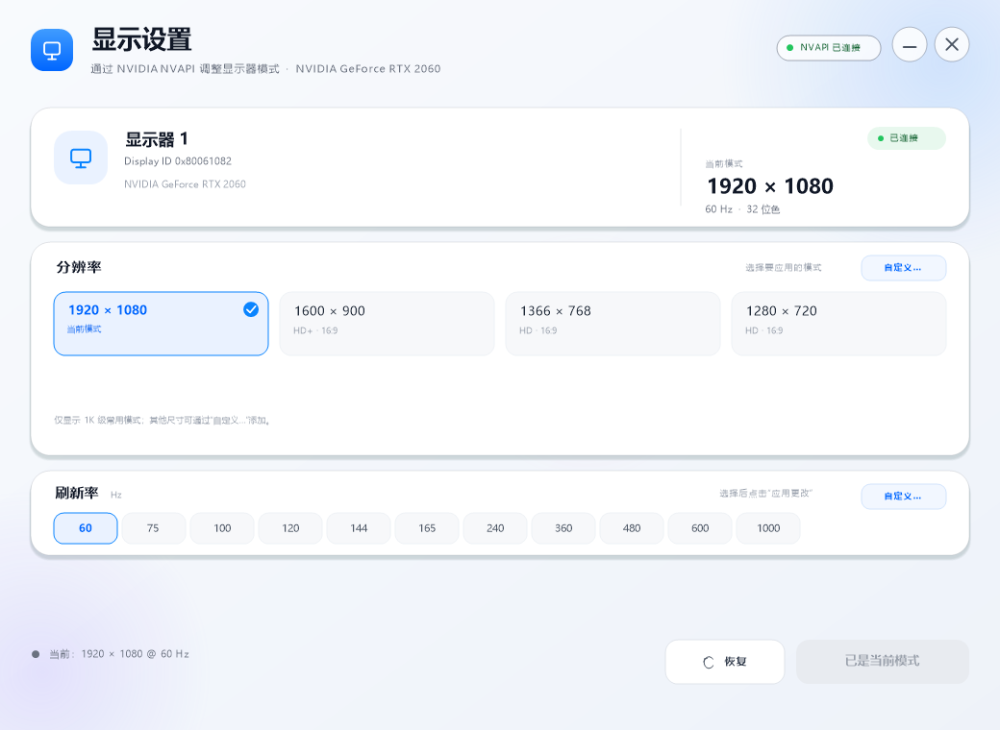

# NvChange

一个用 C++ 编写的 Windows 显示设置工具：**直接调用 NVIDIA NVAPI 修改分辨率与刷新率**，不经过 Windows 显示设置面板。包含一个 iOS 风格的窗口程序，以及一个适合脚本调用的命令行版本。当前版本 **1.2.0**。



## 功能

- 窗口程序：1040×760 的大尺寸卡片界面，分辨率只保留 1920×1080、1600×900、1366×768、1280×720 等 1K 级预设；刷新率提供 60–1000 Hz 的常用档位，并支持用户自定义刷新率。
- 自定义分辨率：窗口内可保存最多 3 个常用分辨率，显示为带“自定义”标记的预设卡片，并持久化到 exe 同目录。
- 自定义刷新率：窗口内可输入 1–1000 Hz 的整数，保存后自动加入刷新率选项并持久化。
- 命令行：`list` 列举显示路径，`set` 修改模式，`restore` 恢复上一次保存的模式。
- 多显示器：每条活动的 NVAPI 显示路径独立处理，可按路径或显示 ID 恢复。
- 校验与持久化：`--validate` 只让驱动校验，不切换；`--persist` 尝试写入持久化配置。
- 自动恢复点：每次应用前把原模式写到 exe 同目录的 `NvChange-last-mode.ini`。

程序运行时从 `%SystemRoot%\System32\nvapi64.dll` 动态加载 NVAPI，通过 `nvapi_QueryInterface` 按函数 ID 取函数指针，因此编译时不需要 `nvapi64.lib`，也不依赖 NVIDIA 控制面板 SDK。

## 直接使用

双击 `NvChange.exe` 打开窗口：

1. 在“分辨率”卡片中选择目标模式。界面只列出 1K 级常用预设，以及你保存的自定义分辨率。
2. 在“刷新率”中选择 60–1000 Hz 的常用档位；需要其他值时点击右侧 **自定义…**。
3. 点击 **应用更改**。屏幕可能短暂黑屏，属于正常现象。
4. 如果效果不理想，点击 **恢复** 回到应用前的模式。
5. 右上角可以最小化或关闭；拖动标题区域可以移动窗口。

### 自定义分辨率


点击“分辨率”卡片右上角的 **自定义…**，可以维护最多 3 个常用分辨率：

- 每行填写宽度和高度；两格都留空表示该槽位不使用。
- 宽度范围 320–16384，高度范围 200–16384；只填一格、非整数或重复项会提示错误。
- 保存后，这些模式会出现在主界面的预设卡片中，副标题为“自定义”；选中后仍按主界面的刷新率应用。
- 全部清空并保存即可删除所有自定义模式。

自定义模式保存在 **exe 所在目录** 的 `NvChange-custom-modes.ini`：

```text
NvChangeCustomModes 1
mode 1600 900
mode 1366 768
```

### 自定义刷新率


点击“刷新率”卡片右上角的 **自定义…**，可以输入 **1–1000 Hz** 的整数：

- 输入非数字、空值或超出 1–1000 范围时，对话框会保留并显示错误。
- 保存后，这个刷新率会插入刷新率选项列表，并立即选中；再点击 **应用更改** 才会真正切换。
- 刷新率只是“请求值”，最终是否可用由显示器和 NVIDIA 驱动校验；不支持的组合会应用失败并保留原模式。

自定义刷新率保存在 **exe 所在目录** 的 `NvChange-custom-refresh.ini`：

```text
NvChangeCustomRefresh 1
hz 500
```

命令行版本是 `NvChange-cli.exe`：

```text
NvChange-cli list
NvChange-cli set 1920 1080 60
NvChange-cli set 1600x900@75 -d 0
NvChange-cli set 1920x1080@60 --validate
NvChange-cli restore
NvChange-cli --help
```

`set` 的刷新率可以省略，省略时保留当前刷新率。`-d/--display N` 选择第 N 条显示路径；只有一台显示器时通常不需要。

### 输出示例

```text
NvAPI 版本：NVidia Complete Version 1.10
GPU：NVIDIA GeForce RTX 2060

共 1 条活动显示路径：

[0] 1920 x 1080 @ 60.000 Hz，32 位色，主显示器
    显示 ID 0x80061082，缩放：GPU 缩放（宽高比，平衡），旋转：0°，刷新率：60.000 Hz
    时序：1920 x 1080，像素时钟 148.50 MHz
```

驱动会对刷新率做量化，例如请求 60 Hz、实际报告 59.954 Hz，这是正常的。本机实测：`set 1600x900@60` 后实际为 `1600x900@59.954`，`restore` 可回到 `1920x1080@60`。

## 编译

要求：64 位 Windows 10/11、NVIDIA 显卡及驱动、支持 C++20 的编译器。

### MinGW-w64

把 MinGW 的 `bin` 加入 `PATH`，或者把便携版放到 `.tools\mingw\mingw64\bin`，然后执行：

```bat
build_mingw.bat
```

脚本会生成 `NvChange.exe`（窗口程序）、`NvChange-cli.exe`（命令行）和资源对象。手工编译：

```bat
if not exist build mkdir build
g++ -std=c++20 -O2 -Wall -Wextra -static -I include src\NvChange.cpp -o NvChange-cli.exe
windres -I include -i resources.rc -o build\app_res.o
g++ -std=c++20 -O2 -Wall -Wextra -static -mwindows -I include src\NvChangeGui.cpp build\app_res.o ^
    -o NvChange.exe -lgdiplus -ldwmapi -lole32 -luuid
```

`-static` 让生成的 exe 不依赖 MinGW 运行库 DLL；`-mwindows` 让窗口程序不弹出控制台。

### MSVC

在 **x64 Native Tools Command Prompt for VS** 中执行：

```bat
build_msvc.bat
```

或手工执行：

```bat
if not exist build mkdir build
cl /nologo /std:c++20 /EHsc /O2 /utf-8 /W4 /permissive- /I include src\NvChange.cpp /Fe:NvChange-cli.exe
rc /nologo /fo build\app.res resources.rc
cl /nologo /std:c++20 /EHsc /O2 /utf-8 /W4 /permissive- /DUNICODE /D_UNICODE ^
   /I include src\NvChangeGui.cpp build\app.res /Fe:NvChange.exe ^
   /link /SUBSYSTEM:WINDOWS gdiplus.lib dwmapi.lib ole32.lib uuid.lib
```

### CMake

```bat
cmake -S . -B build
cmake --build build --config Release
```

CMake 会生成 `NvChange`（窗口程序）与 `NvChangeCli`（命令行）两个目标，并把资源图标编译进去。本机没有安装 CMake，因此 CMake 路径未实际执行；MinGW 脚本和生成的 exe 已实测。

## 恢复点

每次在窗口里点击应用，或执行 `NvChange-cli set` 前，程序都会在 **exe 所在目录** 写入 `NvChange-last-mode.ini`，记录所有活动显示路径的原始模式：

```text
NvChangeBackup 1
path 0
display 2147881090
source 0
width 1920
height 1080
refresh 60000
```

`restore` 会优先按显示 ID 匹配，匹配不到再按路径索引恢复。该文件是普通文本，可以手动查看或删除；删除后“恢复”会提示没有恢复点。

如果切换后屏幕黑屏，可以等待 Windows 的显示恢复超时，或重新插拔显示器/重启；下次启动后仍可用 `NvChange-cli restore`。

## 实现要点

1. `LoadLibraryW(%SystemRoot%\System32\nvapi64.dll)`，再 `GetProcAddress("nvapi_QueryInterface")`。
2. 用函数 ID 取得 `NvAPI_Initialize`、`NvAPI_DISP_GetDisplayConfig`、`NvAPI_DISP_SetDisplayConfig` 等函数。
3. 按 NVAPI 官方 `DisplayConfiguration` 示例的三遍分配方式读取配置：
   - 第一遍取路径数量；
   - 第二遍取每条路径的 target 数量；
   - 第三遍填满 `sourceModeInfo`、`targetInfo` 和 `details`。
4. 修改目标路径的 `sourceModeInfo[0].resolution`，以及 target 的 `details->refreshRate1K`（单位 mHz）。
5. 调用 `NvAPI_DISP_SetDisplayConfig(count, paths, flags)` 应用；`--validate` 时传入 `NV_DISPLAYCONFIG_VALIDATE_ONLY`，`--persist` 时传入 `NV_DISPLAYCONFIG_SAVE_TO_PERSISTENCE`。

窗口程序用 Win32 + GDI+ 手绘界面，没有第三方 UI 框架：双缓冲位图、渐变背景、圆角卡片、阴影、DWM 圆角与自定义命中测试。共享的 NVAPI 逻辑在 `src/NvChangeCore.h`，GUI 与 CLI 都包含它。

### MinGW 下的 NVAPI 头文件适配

官方 `nvapi.h` 末尾的 `nvapi_lite_salend.h` 会取消定义 Microsoft SAL 宏。MinGW 没有定义这些宏，因此源码在非 MSVC 下这样处理：

```cpp
#include <windows.h>
// 所有标准库头必须放在 nvapi.h 之前
#ifndef _MSC_VER
#define __NVAPI_EMPTY_SAL
#endif
#include "nvapi/nvapi.h"
```

- `__NVAPI_EMPTY_SAL` 必须在包含头文件之前定义，且只定义在源文件中，避免全局污染。
- `<vector>`、`<string>` 等标准库头必须放在 `nvapi.h` 之前，否则空的 `__in` 宏会替换 libstdc++ 里的参数名，产生难以理解的模板错误。

## 文件结构

```text
NvChange/
├─ src/
│  ├─ NvChangeCore.h         共享 NVAPI 核心（动态加载、读取/设置、备份、自定义模式/刷新率）
│  ├─ NvChangeGui.cpp        iOS 风格窗口程序（含自定义分辨率、刷新率编辑器）
│  └─ NvChange.cpp           命令行版本
├─ include/nvapi/            NVIDIA 官方 NVAPI 头文件（MIT）
├─ docs/                     截图与演示 GIF
├─ app.ico                   应用图标
├─ resources.rc              图标资源
├─ CMakeLists.txt
├─ build_mingw.bat
├─ build_msvc.bat
├─ NvChange.exe              已编译的窗口程序（x64，静态链接 MinGW 运行库）
├─ NvChange-cli.exe          已编译的命令行版本
└─ README.md
```

`include/nvapi` 中的头文件来自 [NVIDIA/nvapi](https://github.com/NVIDIA/nvapi)，遵循其 MIT 许可证，见 `include/nvapi/License.txt`。

## 限制与注意

- 需要 NVIDIA 驱动；非 NVIDIA 显卡、部分远程桌面/虚拟显示器上 NVAPI 可能不可用。
- 设置的分辨率和刷新率必须是显示器和驱动支持的模式。命令行建议先加 `--validate`；窗口程序依赖 `SetDisplayConfig` 的返回状态，失败时会在底部显示错误。
- 修改显示模式会短暂黑屏，这是正常的。
- 程序以当前用户权限运行即可，不需要管理员权限；某些企业策略可能限制显示配置修改。
- 窗口按 1040×760 DIP 固定布局，适合 1920×1080 及以上的桌面；在 1280×720 等小屏上底部可能贴近任务栏。
- `--persist` 的持久化效果未在测试机上验证；日常使用普通应用即可，重启后 Windows 通常会记住当前模式。
- 自定义分辨率只是保存“宽度×高度”并作为预设使用；驱动仍会校验该模式是否被显示器支持，不支持时应用会失败并保留原模式。
